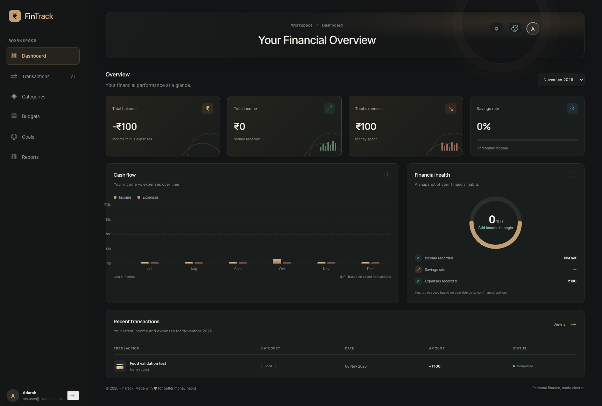
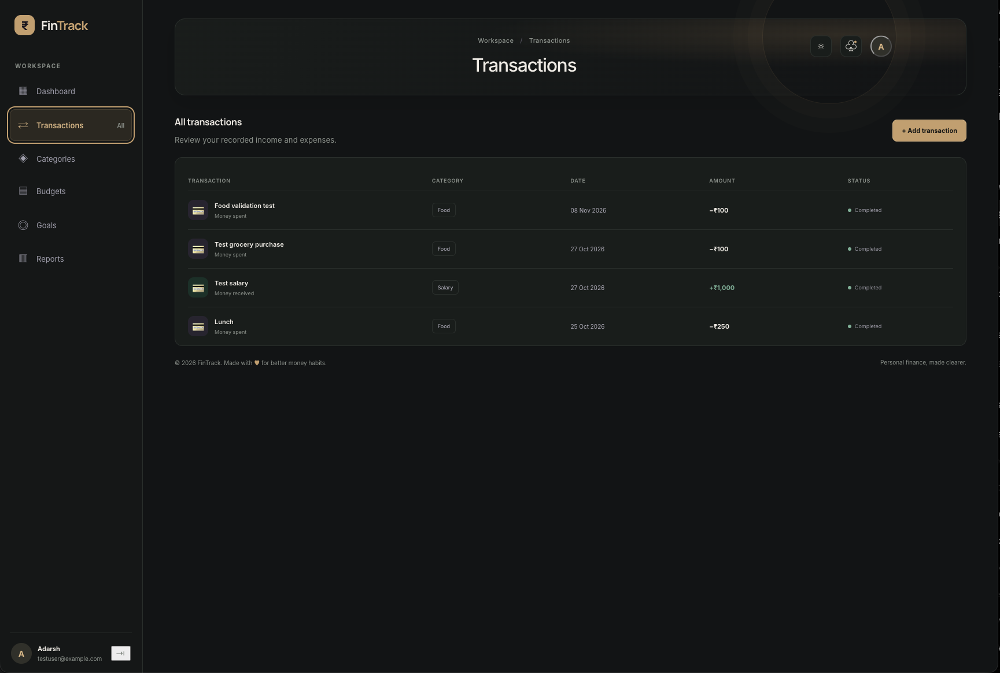
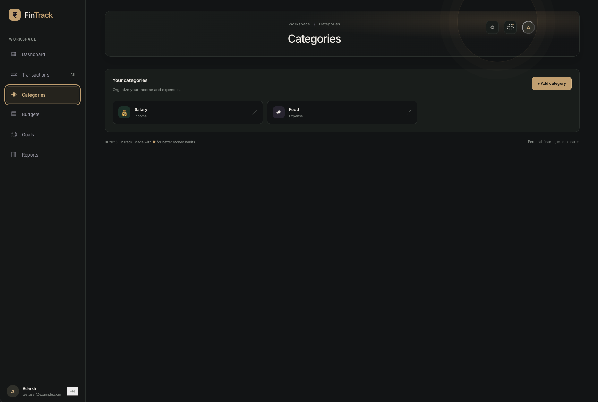
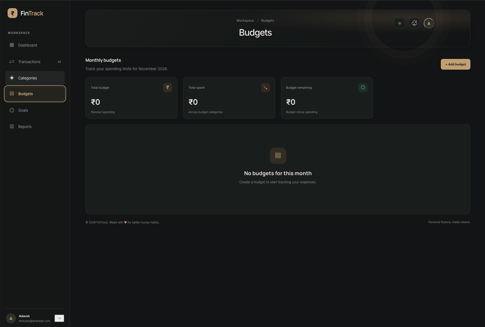
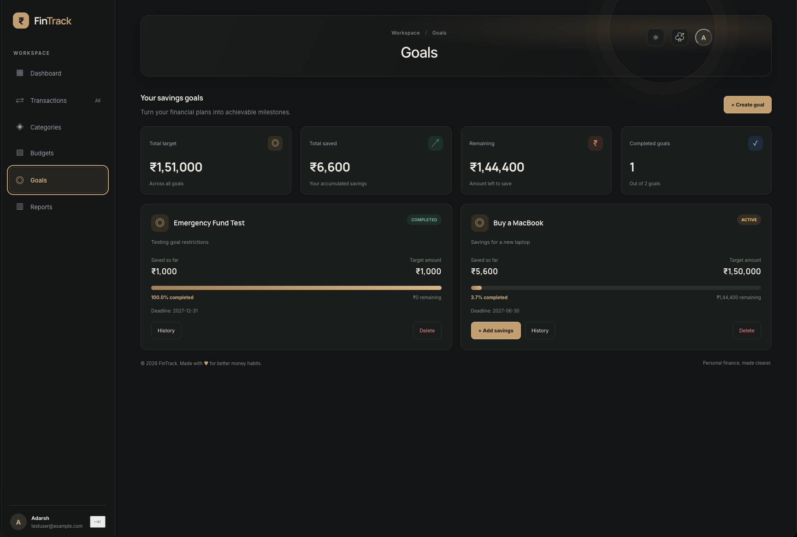
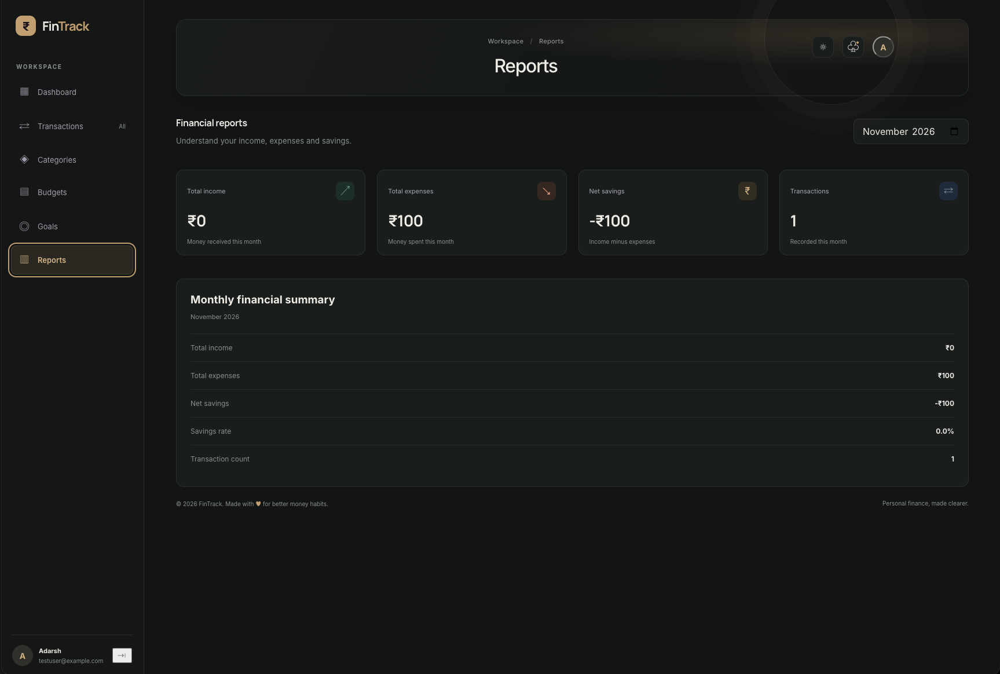

# 💰 FinTrack — Personal Finance Management System

A modern personal finance management application built with **React, JavaScript, and Vite**, designed to help users track income, manage expenses, organize budgets, set savings goals, and understand their financial habits.

FinTrack provides a centralized financial dashboard with monthly reports, cash-flow visualization, and financial health insights through a clean, intuitive interface.

---

## 📸 Application Preview

### 1. Dashboard

Get a complete overview of your financial activity, including total balance, income, expenses, savings rate, cash flow, and financial health.

### 2. Transaction Management

Record and review income and expenses with categories, dates, amounts, and transaction statuses.

### 3. Category Management

Organize your financial activity using income and expense categories.

### 4. Budget Management

Create monthly spending limits and monitor your budget utilization.

### 5. Savings Goals

Set financial targets, track savings progress, manage contributions, and monitor deadlines.

### 6. Financial Reports

Analyze monthly income, expenses, net savings, savings rate, and transaction counts.

---

## ✨ Features

### Financial Dashboard
- Centralized financial overview.
- Total balance, income, and expense summaries.
- Monthly savings rate.
- Cash-flow visualization.
- Financial health score.

### Transaction Management
- Record income and expenses.
- Assign transactions to categories.
- Track transaction dates and amounts.
- View transaction history and status.

### Category Management
- Organize income and expense categories
